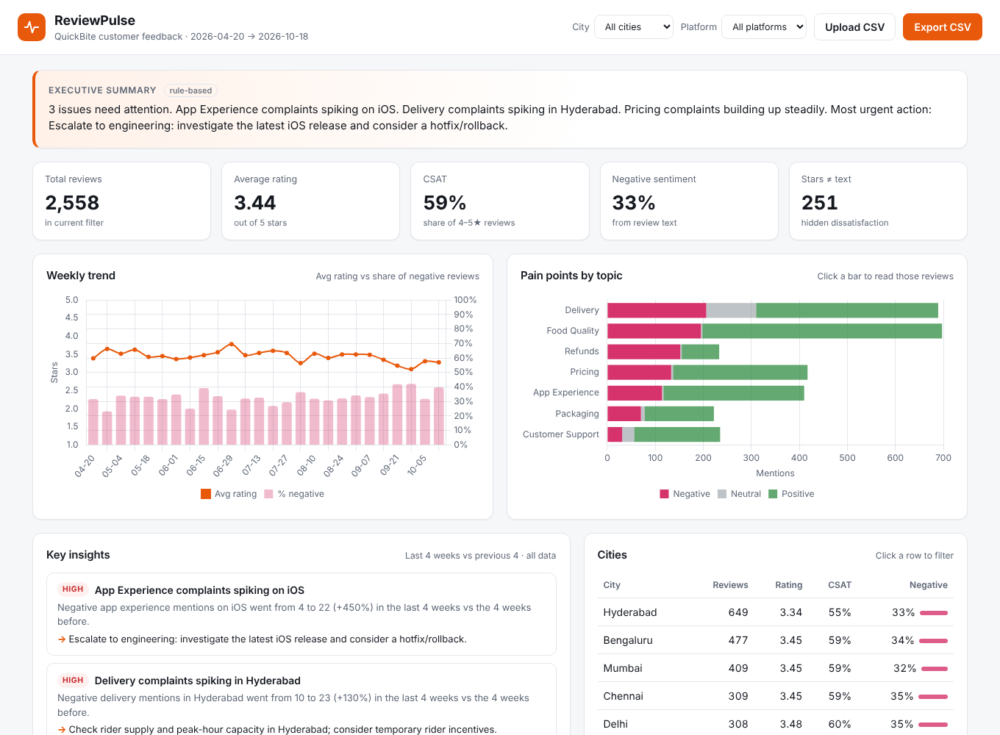

# ReviewPulse — Customer Feedback Analytics Platform

Turns thousands of raw customer reviews into **business decisions**: what customers are unhappy about, where, since when, and what to do about it.



**Live demo:** _add your Render URL here_ · **API docs:** `/docs`

## The problem
A food-delivery company (fictional "QuickBite") gets thousands of app reviews a month. Managers only see the average star rating, which hides *why* customers are unhappy and *which* city or platform is affected.

## What it does
| Feature | How |
|---|---|
| **CSV ingestion pipeline (ETL)** | Validates, cleans and loads reviews; skips bad rows and reports them |
| **Sentiment analysis** | VADER model + custom food-delivery lexicon (84% agreement with star ratings) |
| **Topic detection** | Multi-label rules: Delivery, Food Quality, Pricing, App, Packaging, Support, Refunds |
| **KPI dashboard** | Avg rating, CSAT, % negative, weekly trend, city & platform breakdown, filters |
| **Automated insights** | Compares last 4 weeks vs previous 4 to flag spiking problems, each with a recommended action |
| **AI executive summary** | Optional LLM (any OpenAI-compatible API, e.g. Gemini free tier); falls back to rule-based text |
| **Hidden dissatisfaction** | Flags reviews where stars contradict the text (e.g. 5★ with a complaint) |
| **Review explorer + CSV export** | Search, filter, paginate, export any slice for stakeholders |

On the demo data the engine automatically detects three planted problems: an **iOS release causing checkout crashes**, a **delivery crisis in Hyderabad**, and **pricing complaints growing after a fee hike**.

## Tech stack
**Backend:** Python, FastAPI, SQLAlchemy 2, Pandas · **Database:** SQLite (dev) / PostgreSQL (Docker) · **NLP:** VADER · **Frontend:** HTML, CSS, JavaScript, Chart.js · **DevOps:** Docker, Docker Compose, GitHub Actions CI, Render · **Quality:** pytest (19 tests), Ruff

## Architecture
```
CSV upload ──► ingest.py (validate, clean) ──► nlp.py (sentiment + topics) ──► SQL database
                                                                                  │
 Browser dashboard ◄── main.py (REST API) ◄── analytics.py (SQL KPIs) ◄───────────┤
                                          ◄── insights.py (rules + optional LLM) ◄┘
```
Schema: `reviews` (1) ──< (many) `review_topics` — a review can mention several topics.

## Run locally
```bash
python -m venv .venv && source .venv/bin/activate      # Windows: .venv\Scripts\activate
pip install -r requirements-dev.txt
uvicorn app.main:app --reload                            # open http://localhost:8000
```
Demo data loads automatically on first start.

```bash
pytest -q                                   # run tests
python scripts/run_sql.py                   # run the SQL analysis queries in sql/
python scripts/evaluate_sentiment.py        # measure sentiment accuracy
docker compose up --build                   # run with PostgreSQL
```

## SQL analysis
`sql/analytics_queries.sql` answers 7 business questions with CTEs, `LAG`, `RANK`, `ROW_NUMBER`, rolling-window averages and conditional aggregation.

## Model evaluation
Using star ratings as weak labels (3★ excluded, n = 2,437): **84.4% agreement**, positive precision 89.6%, negative precision 88.2%, negative recall 78.0%. Known limitation: lexicon models miss phrases like "got no help"; a fine-tuned transformer would improve recall.

## API
| Method | Endpoint | Purpose |
|---|---|---|
| GET | `/api/dashboard?city=&platform=` | KPIs, trend, topics, segments |
| GET | `/api/insights` | Ranked findings with recommended actions |
| GET | `/api/summary` | Executive summary (LLM or rules) |
| GET | `/api/reviews` | Filter / search / paginate reviews |
| GET | `/api/export.csv` | Download filtered reviews |
| POST | `/api/upload` | Upload a CSV (`review_text`, `rating`, `date`, optional `city`, `platform`) |

## Data
`data/sample_reviews.csv` is **synthetic** demo data produced by `scripts/generate_data.py` (seeded, reproducible). Upload any real review CSV with the same columns to analyse real data.
